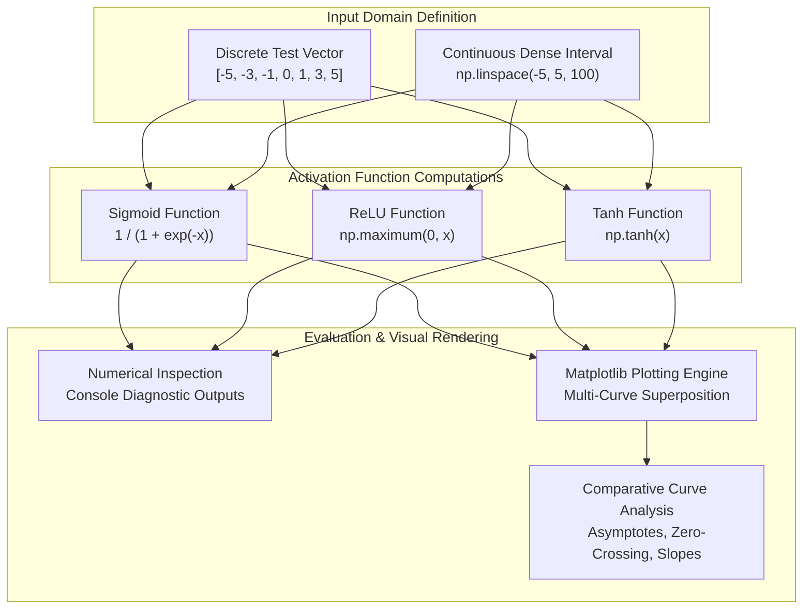

<div align="center">

<a href="https://github.com/akashvenkey/Deep-Learning-">

</a>


### 🔗 **Project Source Link:** [https://github.com/akashvenkey/Deep-Learning-](https://github.com/akashvenkey/Deep-Learning-)

[](https://github.com/akashvenkey/Deep-Learning-)
[](https://github.com/akashvenkey/Deep-Learning-.git)

[](https://www.python.org/)
[](https://jupyter.org/)
[](https://numpy.org/)
[](https://matplotlib.org/)
[](#)
[](#)

</div>

---

## 📌 Executive Summary & Overview

Artificial Neural Networks (ANNs) rely on non-linear activation functions to project high-dimensional representations into separable decision boundaries. Without non-linearity, deep multilayer networks collapse into trivial linear transformations regardless of their architectural depth.

The **Deep Learning Lab** repository provides an empirical and mathematical benchmarking platform exploring fundamental neural activation mechanics. It houses vectorized Python implementations of **Sigmoid**, **Rectified Linear Unit (ReLU)**, and **Hyperbolic Tangent (Tanh)** functions, assessing their response characteristics, derivative saturation behaviors, and computational dynamics. Furthermore, this repository bridges core mathematical foundations with socio-technical context through applied research papers investigating **AI in Entertainment** and **Ethical Considerations in Deep Learning**.

---

## 📑 Interactive Table of Contents

- [📌 Executive Summary & Overview](#-executive-summary--overview)
- [✨ Key Features & Capabilities](#-key-features--capabilities)
- [🔬 Mathematical Formulations](#-mathematical-formulations)
- [🏗 System Architecture & Processing Pipeline](#-system-architecture--processing-pipeline)
- [🛠 Tech Stack Breakdown](#-tech-stack-breakdown)
- [🚀 Reproducible Quickstart & Setup](#-reproducible-quickstart--setup)
- [📂 Project Directory Layout](#-project-directory-layout)
- [👨‍💻 Author & Contributions](#-author--contributions)

---

## ✨ Key Features & Capabilities

- **⚡ Vectorized Numerical Implementations:** Custom implementations of Sigmoid, ReLU, and Tanh utilizing vectorized NumPy operations for optimal runtime execution.
- **📈 Continuous Response Curve Benchmarking:** High-resolution sampling over continuous intervals ($x \in [-5, 5]$ with 100 discrete increments) to visualize functional gradients and asymptotic limits.
- **🔍 Vanishing Gradient & Saturation Diagnostics:** Comparative analysis highlighting how Sigmoid and Tanh exhibit asymptotic gradient compression at extreme input regimes, and how ReLU addresses vanishing gradient limitations.
- **📚 Applied AI Research & Ethical Analysis:**
  - *AI in Entertainment:* Systematic review of procedural generation, generative media, recommendation algorithms, and visual effects pipelines.
  - *Ethical Considerations in Deep Learning:* In-depth evaluation of algorithmic bias, model transparency, training dataset representation, and societal impact.

---

## 🔬 Mathematical Formulations

| Activation Function | Formulation | Output Range | Key Characteristics |
| :--- | :---: | :---: | :--- |
| **Sigmoid** | $\sigma(x) = \frac{1}{1 + e^{-x}}$ | $(0, 1)$ | Smooth, probability-interpretable, susceptible to gradient saturation for $|x| \gg 0$. |
| **ReLU** | $f(x) = \max(0, x)$ | $[0, \infty)$ | Piecewise linear, non-saturating for positive inputs, computationally efficient. |
| **Hyperbolic Tangent (Tanh)** | $\tanh(x) = \frac{e^x - e^{-x}}{e^x + e^{-x}}$ | $(-1, 1)$ | Zero-centered, steeper gradient dynamics than Sigmoid, still saturates at extremes. |

---

## 🏗 System Architecture & Processing Pipeline

The following diagram illustrates the numerical evaluation and visualization pipeline implemented in `Project_5 (1).ipynb`:



---

## 🛠 Tech Stack Breakdown

| Category | Component | Description |
| :--- | :--- | :--- |
| **Language** | Python 3.10+ | Scientific computing and algorithm implementation |
| **Numerical Libraries** | NumPy | High-performance array operations and mathematical vectorization |
| **Visualization** | Matplotlib (pyplot) | Multi-curve coordinate generation and grid rendering |
| **Execution Environment** | JupyterLab / Jupyter Notebook | Interactive notebook execution and cell output validation |
| **Research Documentation** | PDF Reports / Technical Papers | Ethics in AI and applied machine learning analyses |

---

## 🚀 Reproducible Quickstart & Setup

Follow these reproducible steps to run the interactive notebooks locally:

### 1. Prerequisites
Ensure you have Python 3.9 or higher and `pip` installed:
```bash
python --version
pip --version
```

### 2. Clone Repository & Setup Environment
```bash
# Clone the repository
git clone https://github.com/akashvenkey/Deep-Learning-.git

# Navigate into the project folder
cd Deep-Learning-

# Create an isolated virtual environment
python -m venv dl_env

# Activate the virtual environment
# Windows (PowerShell):
.\dl_env\Scripts\Activate.ps1
# Linux / macOS:
# source dl_env/bin/activate
```

### 3. Install Dependencies
```bash
pip install numpy matplotlib jupyterlab
```

### 4. Launch Jupyter Notebook
```bash
jupyter lab "Project_5 (1).ipynb"
```

---

## 📂 Project Directory Layout

```plaintext
Deep-Learning-/
├── Project_5 (1).ipynb                                    # Jupyter Notebook implementing & evaluating activation functions
├── AI_in_Entertainment.pdf                               # Research report on deep learning pipelines in entertainment
├── Project4_Ethical_Considerations_in_Deep_Learning+(4).pdf # Technical analysis on bias, safety & ethics in AI
├── IMG_20260827_131327.jpg                               # Supporting diagrammatic asset
└── README.md                                             # Repository documentation & technical blueprint
```

---

## 👨‍💻 Author & Contributions

**Akash V**  
- **GitHub:** [@akashvenkey](https://github.com/akashvenkey)  
- **Specialization:** Deep Learning, Neural Network Dynamics & Applied AI  
- **Affiliation:** BCA (Hons), Alliance University, Bangalore  

Contributions, issue reports, and academic discussions on neural activations are welcome. If this repository aids your research or learning, consider giving it a ⭐!

---

<div align="center">

<a href="https://github.com/akashvenkey/Deep-Learning-">

</a>


### 🔗 **Project Source Link:** [https://github.com/akashvenkey/Deep-Learning-](https://github.com/akashvenkey/Deep-Learning-)

[](https://github.com/akashvenkey/Deep-Learning-)
[](https://github.com/akashvenkey/Deep-Learning-.git)

</div>